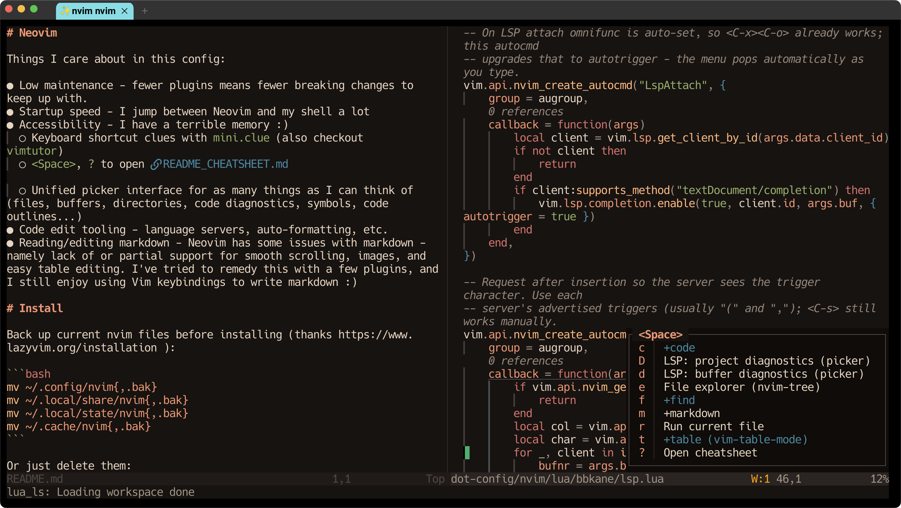

# Neovim

(screenshot taken Thu 2026-11-26)



Things I care about in this config:

- Low maintenance - fewer plugins means fewer breaking changes to keep up with.
- Startup speed - I jump between Neovim and my shell a lot
- Accessibility - I have a terrible memory :)
  - Keyboard shortcut clues with `mini.clue` (also checkout `vimtutor`)
  - `<Space>`, `?` to open [`README_CHEATSHEET.md`](./README_CHEATSHEET.md)
  - Unified picker interface for as many things as I can think of (files, buffers, directories, code diagnostics, symbols, code outlines...)
- Code edit tooling - language servers, auto-formatting, etc.
- Reading/editing markdown - Neovim has some issues with markdown - namely lack of or partial support for smooth scrolling, images, and easy table editing. I've tried to remedy this with a few plugins, and I still enjoy using Vim keybindings to write markdown :)

# Install

Back up current nvim files before installing (thanks https://www.lazyvim.org/installation ):

```bash
mv ~/.config/nvim{,.bak}
mv ~/.local/share/nvim{,.bak}
mv ~/.local/state/nvim{,.bak}
mv ~/.cache/nvim{,.bak}
```

Or just delete them:

```bash
rm -rf ~/.config/nvim ~/.local/share/nvim ~/.local/state/nvim ~/.cache/nvim
```

## Symlink

Symlink nvim config directory (from root `dotfiles` directory):

```bash
fling link -s nvim
```

## Install dependencies

If using Wezterm, install [WezTerm terminfo](../wezterm/README.md#install) for proper scrolling. My `zsh` configuration launches `vim` and `vimdiff` with `TERM=wezterm`.

Install other dependencies:

```bash
# LSPs and tree-sitter
# bash-language-server auto-uses shellcheck + shfmt
brew install bash-language-server gopls lua-language-server ruff shellcheck shfmt tree-sitter-cli ty

# rust-analyzer ships as a rustup component (needs https://rustup.rs)
rustup component add rust-analyzer

# img-clip.nvim (:checkhealth img-clip)
brew install pngpaste # for macOS
sudo apt install wl-clipboard # for Wayland or xclip for X11
```

See other tree-sitter requirements [here](https://github.com/nvim-treesitter/nvim-treesitter/tree/main#requirements) (most likely pre-installed)

Open `nvim` - note that it'll freeze for a tad the first time because it's cloning `lazy.nvim` with git and setting up treesitter. Wait for that and then it'll all work out......

# Config Notes

Some files are auto-loaded for certain events.

| Path | Notes |
| --- | --- |
| `init.lua` | Entrypoint loaded first at startup |
| `lua/bbkane/*.lua` | modularized configs |
| `lsp/<name>.lua` | Language server config auto-read when `vim.lsp.enable("<name>")` runs |
| `ftplugin/<filetype>.lua` | Buffer-local settings for specific file types (e.g. `ftplugin/gitconfig.lua` forces real tabs) |
| `templates/` | Templates for new files loaded by the `BufNewFile` autocmd in `autocmds.lua` |
| `.luarc.json` | Lua LSP settings for editing this config read by lua-language-server |
| `lazy-lock.json` | Plugin version lockfile for lazy.nvim |

Other special folders Neovim auto-loads but this config doesn't currently use: `plugin/` (run once at startup, after plugins), `ftdetect/` (older alternative to `vim.filetype.add`), `indent/`, `syntax/`, and `after/` (same names, sourced last to override).

To get autocompletions and such when editing this Lua code, make sure [`.luarc.json`](dot-config/nvim/.luarc.json) has the current`$VIMRUNTIME` values in `.workspace.library` paths. 

```bash
# find $VIMRUNTIME for .luarc.json
nvim --headless -u NONE -i NONE --clean +'echo $VIMRUNTIME' +q
```

# Colorschemes Notes

## Good built-in colorschemes

- darkblue
- default (bad for markdown, great for lua)
- desert
- elflord
- habamax
- industry

stopped here...

- slate
- wildcharm

## Good plugin colorschemes

See [Top Neovim Colorschemes in 2025](https://dotfyle.com/neovim/colorscheme/top)

- tokyonight-night
